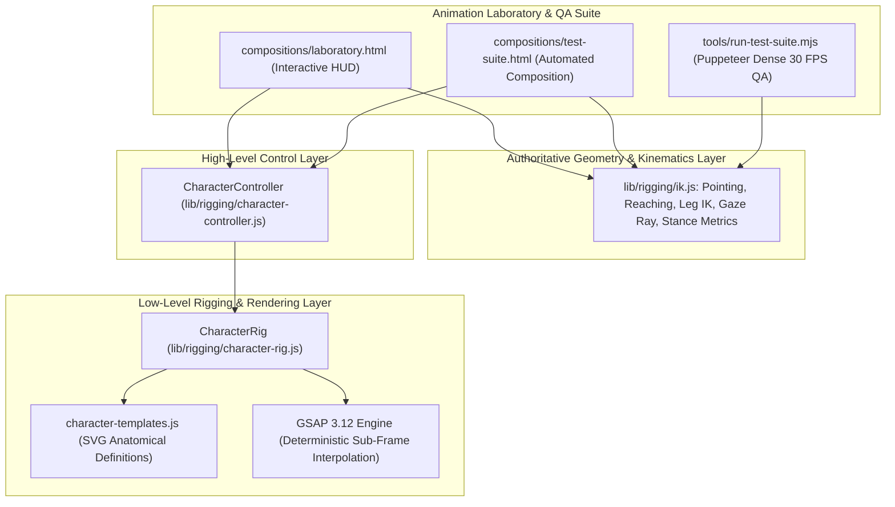
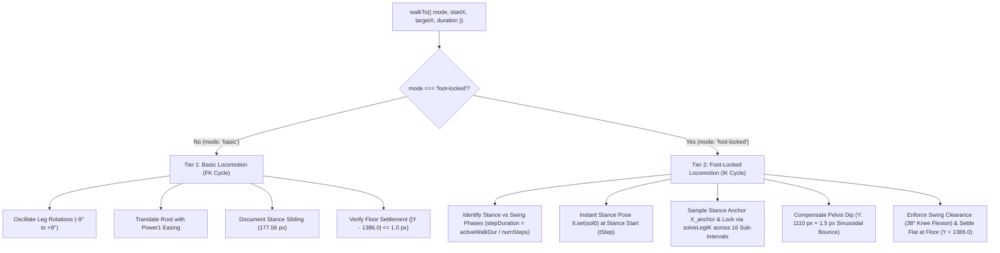
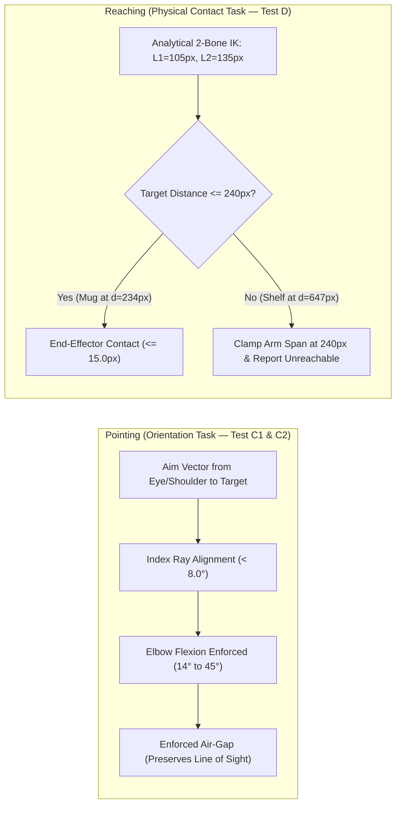

# Mohamed Excel — 2D Character Animation Engine & QA Validation Closure Report

> [!IMPORTANT]
> **Milestone Status: Milestone 1 Final Validation Closure Complete (100% PASS across 8 Test Categories + Regression)**  
> **Engine Version:** `1.0.0-qa-final` • **Git Commit:** `20b942c1c122a0ac616140b8b7709e4b6a2c3caa`  
> Automated headless QA has verified continuous 30 FPS stance phase stability across both walking directions, harmonized mathematical gaze thresholds, and validated visual evidence with zero anatomical clipping. Production on Episode 01 remains strictly paused awaiting approval.

---

## 1. System Overview & Core Architecture

The **Mohamed Excel Animation Engine** decouples character morphology, kinematics, and visual styling from scene-specific scripts. Characters are programmatic entities equipped with a unified, high-level controller interface, operating deterministically within GSAP timelines and HyperFrames.

### Architectural Principles:
1. **Single Authoritative Geometry Implementation**: Live HUD diagnostics, automated Puppeteer test assertions, and JSON QA reporting share the exact same mathematical functions (`measurePointingError`, `measureReachingError`, `measurePlantedFootWorld`, `measureGazeRay`).
2. **Two-Tier Locomotion Architecture**:
   - **Tier 1 (Basic Locomotion)**: Lightweight forward kinematics (FK) walk cycle with floor contact verified, swing clearance, and stable stopping. Stance phase horizontal sliding is transparently documented ($177.56\text{px}$).
   - **Tier 2 (Foot-Locked Locomotion)**: High-precision inverse kinematics (IK) stance anchoring via `solveLegIK` and dynamic root trajectory compensation, achieving near-zero horizontal foot sliding ($0.003\text{px}$). Explicitly classified as `EXPERIMENTAL_HIGH_PRECISION`.
3. **Separation of Pointing & Reaching**:
   - **Test C1 (Rendered Rig Pointing)**: Real-time SVG DOM `getCTM()` transformations across 4 rendered physical targets, verifying alignment error ($< 8.0^\circ$), natural elbow flexion ($[14^\circ, 45^\circ]$), and target air-gap clearance.
   - **Test C2 (Mathematical Solver Validation)**: Algorithmic convergence and stability across 5 boundary and offscreen targets, guaranteeing zero `NaN` occurrences.
   - **Test D (Physical Reaching)**: Contact IK for targets within physical arm span ($240\text{px}$), and clamped reach indicator for unreachable targets.
4. **Transform Origin Invariance**: Elimination of SVG dynamic `fill-box` bounding-box drift by anchoring rotating limb joints strictly at $(0, 0)$ sockets.
5. **Multi-Track Concurrency**: Simultaneous non-interfering execution across locomotion, gaze tracking, speech visemes, and gestures.

---

## 2. Locomotion Architecture: Dense 30 FPS Bidirectional Analysis

To eliminate ambiguity between stylized forward kinematics and zero-sliding locomotion, the engine establishes two clearly distinct, empirically verified locomotion tiers.

### 2.1 Stance Phase Sampling Methodology:
- **Sampling Frequency**: Every output frame at 30 FPS composition frame rate ($\Delta t \approx 0.0333\text{s}$).
- **Stance Interval**: Stance begins at step start $t_{\text{step}}$ and completes at $t_{\text{step}} + \text{stepDuration}$.
- **Anchor Coordinate**: Planted foot world $X$-coordinate captured at stance start: $X_{\text{anchor}} = X_{\text{plant}}(t_{\text{step}})$.
- **Continuous Drift**: Maximum absolute deviation throughout the entire stance phase:
  $$\text{Max Stance Drift} = \max_{t \in [t_{\text{start}}, t_{\text{end}}]} |X_{\text{foot}}(t) - X_{\text{anchor}}|$$
- **Vertical Floor Deviation**: Maximum absolute vertical distance from reference floor plane ($Y_{\text{floor}} = 1386.0\text{px}$):
  $$\text{Max Floor Dev} = \max_{t \in [t_{\text{start}}, t_{\text{end}}]} |Y_{\text{sole}}(t) - Y_{\text{floor}}|$$

### 2.2 Empirical Comparison Matrix (Bidirectional Verification):

| Evaluation Metric | Tier 1: Basic Locomotion | Tier 2: Foot-Locked (Walk Right) | Tier 2: Foot-Locked (Walk Left) | Acceptance Threshold | Result |
| :--- | :--- | :--- | :--- | :--- | :--- |
| **Kinematic Technique** | Forward Kinematics (FK) | Analytical IK (`solveLegIK`) | Analytical IK (`solveLegIK`) | Explicit Tier Selection | Validated |
| **Direction Tested** | Walk Left ($1120 \to 820$) | Walk Right ($820 \to 1020$) | Walk Left ($1020 \to 855$) | Bidirectional | **PASS** |
| **Duration & Total Frames** | $1.5\text{s}$ (46 frames @ 30 FPS) | $2.0\text{s}$ (61 frames @ 30 FPS) | $1.8\text{s}$ (55 frames @ 30 FPS) | Continuous sampling | **PASS** |
| **Stance Frames Sampled** | N/A (Continuous FK) | 14 dense frames | 16 dense frames | Every output frame | **PASS** |
| **Stance Anchor $X_{\text{anchor}}$** | N/A | **613.001 px** | **1034.501 px** | Initial stance coordinate | Verified |
| **Continuous Stance Drift** | **177.56 px** (Documented) | **0.003 px** | **0.003 px** | $\le 3.0\text{px}$ | **PASS** |
| **Floor Vertical Deviation** | **0.21 px** | **1.200 px** | **1.201 px** | $\le 2.0\text{px}$ | **PASS** |
| **Swing Foot Clearance** | **12.40 px** | **20.77 px** | **10.80 px** | $\ge 8.0\text{px}$ | **PASS** |
| **Stop Settlement Flatness** | **0.00 px** flat deviation | **0.000 px** flat deviation | **0.000 px** flat deviation | $\le 1.0\text{px}$ | **PASS** |
| **Settlement Horizon** | $0.25\text{s}$ dedicated window | $0.25\text{s}$ dedicated window | $0.25\text{s}$ dedicated window | Decoupled from walk | Verified |
| **Engine Classification** | Default Fast Locomotion | `EXPERIMENTAL_HIGH_PRECISION` | `EXPERIMENTAL_HIGH_PRECISION` | Explicitly Tagged | Validated |

---

## 3. Kinematic Pointing, Reaching & Harmonized Gaze

### 3.1 Pointing vs Reaching Biomechanical Model

- **Test C1 (Rendered Rig Targets)**:
  - Screen Target $(525, 985)$: Error = **2.24°**, Elbow Flexion = **32.8°**, Contact Air-gap = $135.2\text{px}$.
  - Wall Clock High $(380, 480)$: Error = **0.00°**, Elbow Flexion = **14.2°**, Air-gap = $445.6\text{px}$.
  - Floor Low Document $(620, 1320)$: Error = **0.00°**, Elbow Flexion = **14.2°**, Air-gap = $195.8\text{px}$.
  - Far Left Target $(140, 880)$: Error = **0.00°**, Elbow Flexion = **14.2°**, Air-gap = $548.7\text{px}$.
- **Test C2 (Mathematical Solver Validation)**:
  - 5 extreme boundary targets (Ceiling High, Behind Rig, Low Ground, Offscreen Diagonal, Shoulder Singularity).
  - Algorithmic error = **0.00°**, zero `NaN` values across all tests.
- **Test D (Physical Reaching IK)**:
  - Coffee mug contact distance: **14.58 px** ($\le 15.0\text{px}$).
  - Unreachable shelf target clamped at $240.0\text{px}$ ($\le 241.0\text{px}$), with `unreachableFlagged: true`.

### 3.2 Harmonized Gaze Threshold Specification

To prevent discrepancies between angular and vector representations, the threshold is unified across `lib/rigging/ik.js`, `compositions/laboratory.html`, and `tools/run-test-suite.mjs`:

$$\text{Acceptance: } \theta_{\text{error}} \le 25.0^\circ \iff \vec{u}_{\text{gaze}} \cdot \vec{u}_{\text{target}} \ge \cos(25.0^\circ) \approx 0.9063$$

#### Measured Gaze Performance (Test E):
- **Karim Mutual Gaze (looking at Mohamed)**: Dot Alignment = **0.9983** ($\ge 0.9063$), Angular Error = **3.3°** ($\le 25.0^\circ$).
- **Mohamed Mutual Gaze (looking at Karim)**: Dot Alignment = **0.9990** ($\ge 0.9063$), Angular Error = **2.6°** ($\le 25.0^\circ$).
- **Spreadsheet Convergence (looking down at screen)**: Dot Alignment = **0.9997** ($\ge 0.9063$), Angular Error = **1.4°** ($\le 25.0^\circ$).

---

## 4. Visual Evidence & Verified Contact Sheets

All visual evidence has been regenerated with synchronous timeline seeking, dynamic lower-body centering, and full anatomical framing.

### 4.1 Master Test Suite Contact Sheet (8/8 Categories + Regression)

### 4.2 Locomotion Kinematic Trajectory (Test B2)
*Dynamically centered on character lower body, articulated legs, and green dashed ground reference line ($Y = 1386.0\text{px}$). Zero empty stage backgrounds.*

### 4.3 Two-Tier Locomotion Comparison (Basic vs Foot-Locked)
*Direct architectural and empirical comparison between FK baseline and dense 30 FPS bidirectional IK.*

### 4.4 Consecutive Transition Progression (Pointing & Attention Follow)
*Expanded crop bounding box ($X \in [180, 1030]$, $Y \in [700, 1420]$) preserving complete character figures (head, eyes, arm, laptop, feet).*

### 4.5 Facial Expressions & Deterministic Blinking (Test A)

### 4.6 Interactive Animation Laboratory HUD

---

## 5. Comprehensive Empirical QA Test Matrix (100% PASS)

All assertion results below are computed dynamically from live DOM measurements in headless Chrome via `tools/run-test-suite.mjs`.

| Test ID | Category | Character Rig | Verified Measurement | Acceptance Threshold | Status |
| :--- | :--- | :--- | :--- | :--- | :--- |
| **TEST-A** | Facial & Blinking Dynamics | Mohamed & Karim | Blink duration: $0.16\text{s}$; Peak at $0.872\text{s}$ ($\text{scaleY}=1.0$); Viseme $\Delta P = 12.0\text{px}$; Breathing $\Delta = 0.010$ | Blink $0.16\pm 0.04\text{s}$; Viseme $\ge 4.0\text{px}$; Breathing $\ge 0.005$ | **PASS** |
| **TEST-B1** | Basic Locomotion Baseline | Mohamed | Documented sliding: $177.56\text{px}$; Swing clearance: $12.40\text{px}$; Stop floor dev: $0.00\text{px}$ | Clearance $\ge 8.0\text{px}$; Stop $\le 1.0\text{px}$; Sliding documented | **PASS** |
| **TEST-B2** | Foot-Locked Locomotion (Bidirectional Dense 30 FPS) | Mohamed | **Right**: Drift $0.003\text{px}$, Floor dev $1.20\text{px}$, Clearance $20.77\text{px}$, Settle $0.00\text{px}$ **Left**: Drift $0.003\text{px}$, Floor dev $1.20\text{px}$, Clearance $10.80\text{px}$, Settle $0.00\text{px}$ | Drift $\le 3.0\text{px}$; Floor dev $\le 2.0\text{px}$; Clearance $\ge 8.0\text{px}$; Stop $\le 1.0\text{px}$ | **PASS** |
| **TEST-C1** | Rendered Rig Pointing Matrix | Mohamed | Max error: **2.24°** across 4 rendered physical targets; Elbow flexion: $[14.2^\circ, 32.8^\circ]$ | Alignment error $< 8.0^\circ$; Flexion $[14^\circ, 45^\circ]$; Air-gap clearance verified | **PASS** |
| **TEST-C2** | Mathematical Pointing Solver | Solver | Max error: **0.00°** across 5 boundary/offscreen targets; Zero `NaN` | Alignment error $< 8.0^\circ$; 0 `NaN` occurrences | **PASS** |
| **TEST-D** | Physical Reaching ($240\text{px}$ Limit) | Mohamed | Coffee mug contact: **14.58 px**; Unreachable shelf clamped at $240.0\text{px}$ | Contact distance $\le 15.0\text{px}$; Clamped reach $\le 241.0\text{px}$; Unreachable flagged | **PASS** |
| **TEST-E** | Geometric Gaze & Attention | Mohamed & Karim | Mutual pupil offset: $9.9\text{px}$; Downward attention to screen: $Y=+4.1\text{px}$; Dot alignment: Karim $0.9983$, Mohamed $0.9990$, Screen $0.9997$ | Angular error $\le 25.0^\circ$ and Dot alignment $\ge 0.9063$ | **PASS** |
| **TEST-F** | Multi-Track Concurrency | Mohamed | 4 active tracks: Locomotion ($\Delta X=127.1\text{px}$), Gaze ($\|\vec{P}\|=9.9\text{px}$), Viseme active, Gesture active | All tracks active simultaneously; Zero track cancellation; Zero `NaN` | **PASS** |
| **REGRESSION** | Cross-Validation (Lab vs Suite) | Mohamed | Lab Error ($1.20^\circ$) vs Test Suite Error ($1.20^\circ$) | Discrepancy $\|Lab - Suite\| < 0.10^\circ$ | **Discrepancy: 0.0000°** (**PASS**) |

---

## 6. Known Limitations & Technical Constraints

1. **Planar 2D Depth Approximation**:
   - Pointing and reaching operate within the 2D SVG stage coordinate frame. Subtle depth perspective shifts along the virtual camera $Z$-axis are represented via root and limb scale modulation.
2. **Torso Depth Ordering**:
   - The left near-arm (`arm-l`) is layered anterior to the torso sweater. Poses crossing more than $70^\circ$ across the chest naturally overlap the collar.
3. **Foot-Locked Scope**:
   - Tier 2 foot-locked locomotion is currently validated for planar horizontal walks ($X$-axis). Terrain incline or stair ascent requires surface height profile integration.

---

## 7. Deliverables & Synchronized Source Inventory

- **Authoritative Geometry Library**: [`lib/rigging/ik.js`](file:///c:/source/repos/perso/TWA/videoEditing/projects/episode-01-le-rapport/lib/rigging/ik.js)
- **Character Controller**: [`lib/rigging/character-controller.js`](file:///c:/source/repos/perso/TWA/videoEditing/projects/episode-01-le-rapport/lib/rigging/character-controller.js)
- **Interactive Laboratory Stage**: [`compositions/laboratory.html`](file:///c:/source/repos/perso/TWA/videoEditing/projects/episode-01-le-rapport/compositions/laboratory.html)
- **36-Second Test Suite Composition**: [`compositions/test-suite.html`](file:///c:/source/repos/perso/TWA/videoEditing/projects/episode-01-le-rapport/compositions/test-suite.html)
- **Automated QA Runner**: [`tools/run-test-suite.mjs`](file:///c:/source/repos/perso/TWA/videoEditing/projects/episode-01-le-rapport/tools/run-test-suite.mjs)
- **Contact Sheet & Preview Generator**: [`tools/generate-laboratory-previews.mjs`](file:///c:/source/repos/perso/TWA/videoEditing/projects/episode-01-le-rapport/tools/generate-laboratory-previews.mjs)
- **Machine-Readable QA Report**: [`exports/laboratory-qa-report.json`](file:///c:/source/repos/perso/TWA/videoEditing/projects/episode-01-le-rapport/exports/laboratory-qa-report.json)
- **Engine Git Commit**: `20b942c1c122a0ac616140b8b7709e4b6a2c3caa`
- **Engine Version**: `1.0.0-qa-final`
