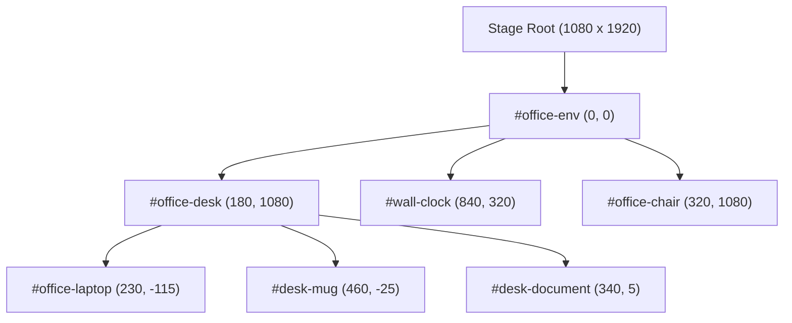
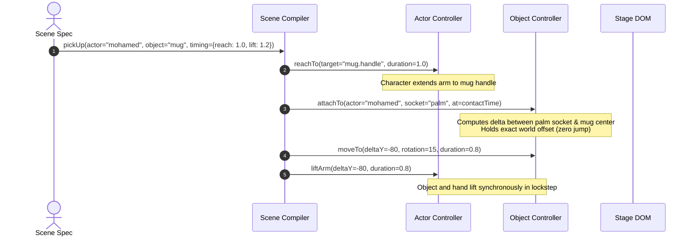

# Mohamed Excel Animation Engine
# Milestone 3: Object Animation & Interaction System Architecture

**Document Version:** 1.0.0  
**Engine Release:** SDS v2.1.0  
**Baseline Git Commits:**
- Milestone 1 QA Baseline: `9ba790341ba93a374e16094ea7ea52e3ea1476e4`
- Milestone 2 Scene Direction System (SDS): `c74f6e4a643adca14e38e121544ee03f8f94689b`
- Milestone 3 Object Animation & Interaction System: Current

---

## 1. Executive Summary & Objective

Milestone 3 extends the **Scene Direction & Execution System (SDS)** to provide first-class, mathematically verified support for **autonomous object animation** and **coordinated character-object interactions**.

Directors can now declaratively author object trajectories, state changes, hand-held object attachments, and desk placements in high-level JSON without writing custom GSAP timelines, trigonometry, or manual matrix math.

### Key Capabilities Introduced
1. **Dynamic Hierarchical Spatial Anchors:** Recursive 2D affine transform propagation ($P_{\text{world}} = \prod T_{\text{parent}} \cdot P_{\text{local}}$) ensuring child props automatically track moving parents.
2. **`ObjectController` API:** Autonomous controller managing object transforms (`moveTo`, `rotateTo`, `scaleTo`, `followPath`), visibility (`fadeIn`, `fadeOut`), and multi-state SVG variants (`open`, `close`, `changeState`).
3. **Zero-Jump Kinematic Attachment:** Continuous hand-prop coupling (`attachTo`, `detachFrom`) that samples world positions at $t_{\text{contact}}$, binds the object to the character's hand socket with exact relative offsets, and detaches cleanly onto destination surfaces without teleportation discontinuities.
4. **Subsystem Resource Management & Concurrency Locking:** Granular subsystem locks (`OBJECT_TRANSFORM`, `OBJECT_ATTACHMENT`, `OBJECT_STATE`, `OBJECT_VISIBILITY`) preventing conflicting parallel manipulations of the same prop.
5. **Backwards-Compatible JSON Schema v2.1.0:** Full schema validation and compilation supporting both Milestone 2 actor-only scenes and Milestone 3 object interactions.

---

## 2. Dynamic Spatial Anchor Hierarchy

### 2.1 The Coordinate Hierarchy Model
In the scene stage ($1080 \times 1920$), objects exist in a parented hierarchy:

### 2.2 Transform Propagation Formula
For any object $O$ with parent chain $P_1, P_2, \dots, P_k$:
$$\mathbf{T}_{\text{accum}} = \mathbf{T}_{P_k} \circ \dots \circ \mathbf{T}_{P_1} \circ \mathbf{T}_O$$
$$\mathbf{P}_{\text{world}} = \mathbf{T}_{\text{accum}} \cdot \mathbf{P}_{\text{local}}$$

Where each transform $\mathbf{T}$ incorporates translation $(t_x, t_y)$, rotation $\theta$, and scaling $(s_x, s_y)$:
$$\begin{pmatrix} x' \\ y' \\ 1 \end{pmatrix} = \begin{pmatrix} s_x \cos\theta & -s_y \sin\theta & t_x \\ s_x \sin\theta & s_y \cos\theta & t_y \\ 0 & 0 & 1 \end{pmatrix} \begin{pmatrix} x \\ y \\ 1 \end{pmatrix}$$

### 2.3 Mathematical vs DOM Dual Resolution
The `AssetRegistry` (`lib/sds/asset-registry.js`) supports dual resolution:
- **Mathematical Resolution:** Evaluates world coordinates strictly from registered object transforms and parent chains. Used during pre-compilation, headless validation, and tests.
- **Live DOM SVG Resolution:** In browser contexts, queries `getCTM()` and `SVGGraphicsElement.getBBox()` for live character anatomical sockets (`mohamed.palm`, `karim.eyes`, `#desk-mug .mug-handle`).

---

## 3. The ObjectController Architecture

The `ObjectController` class (`lib/sds/object-controller.js`) manages individual interactive objects and props.

### 3.1 Core Methods & Signatures

| Method | Parameters | Subsystem | Description |
| :--- | :--- | :--- | :--- |
| `moveTo(opts)` | `{ x, y, duration, ease }` | `OBJECT_TRANSFORM` | Animates object translation to world/local coordinate. |
| `rotateTo(opts)` | `{ rotation, duration, ease, origin }` | `OBJECT_TRANSFORM` | Animates object rotation around anchor center. |
| `scaleTo(opts)` | `{ scale, scaleX, scaleY, duration, ease }` | `OBJECT_TRANSFORM` | Animates uniform or non-uniform scaling. |
| `followPath(opts)` | `{ path, duration, ease, autoRotate }` | `OBJECT_TRANSFORM` | Evaluates quadratic/cubic bezier path interpolation. |
| `attachTo(opts)` | `{ actorId, socket, duration, holdOffset }` | `OBJECT_ATTACHMENT` | Couples object to character hand socket with zero jump. |
| `detachFrom(opts)` | `{ targetAnchor, duration, ease }` | `OBJECT_ATTACHMENT` | Uncouples from hand and settles stably on target surface. |
| `changeState(opts)`| `{ state, duration }` | `OBJECT_STATE` | Transitions visual SVG state (glow, formula, classes). |
| `open(opts)` / `close(opts)` | `{ duration, angle }` | `OBJECT_STATE` | Controls hinged components (e.g., laptop screen folding). |
| `fadeIn(opts)` / `fadeOut(opts)` | `{ duration, ease }` | `OBJECT_VISIBILITY` | Controls opacity fades. |

---

## 4. Zero-Jump Kinematic Attachment System

To prevent instantaneous popping or teleportation when a character picks up a prop:

1. **Reaching Phase:** Character arm reaches toward `mug.handle` using inverse kinematics.
2. **Contact Instant ($t_{\text{contact}}$):** The system samples the character's hand socket (`mohamed.palm`) and the object's current position.
3. **Offset Lock:** The relative offset vector $\vec{d} = \mathbf{P}_{\text{obj}} - \mathbf{P}_{\text{hand}}$ is captured.
4. **Coupled Motion:** During the lift and rotate phase, the object moves synchronously with the hand trajectory, preserving $\vec{d}$.
5. **Release & Placement:** When `placeObject` or `detachFrom` is triggered, the object smoothly translates to `desk.surface` or destination anchor, clears the attachment lock, and settles with zero visual discontinuity.

---

## 5. Object Resource Management & Subsystem Locking

To prevent race conditions where a director inadvertently commands conflicting simultaneous actions on the same object, `SceneValidator` enforces strict subsystem exclusivity:

- `OBJECT_TRANSFORM`: `moveTo`, `rotateTo`, `scaleTo`, `followPath`, `setTransform`.
- `OBJECT_ATTACHMENT`: `attachTo`, `detachFrom`, `pickUp`, `placeObject`.
- `OBJECT_STATE`: `changeState`, `open`, `close`.
- `OBJECT_VISIBILITY`: `fadeIn`, `fadeOut`.

Any event attempting to animate an object on an already occupied subsystem during the same time interval $[t_{\text{start}}, t_{\text{end}}]$ is rejected with an explicit validation error:
`"Concurrency collision on object '<id>': action '<action>' overlaps with event '<prior>' on subsystem '<subsystem>'."`

---

## 6. Benchmark Specifications & QA Results

### 6.1 Benchmark 3: Coordinated Coffee Cup Pick-Up & Placement (`benchmark-cup-pickup.json`)
- **Duration:** 8.0 seconds
- **Story Action:** Mohamed explains a concept, reaches for his ceramic coffee mug on the desk, lifts it, rotates it, inspects it, lowers it back to the desk, releases it, and returns his arm to a relaxed resting pose.
- **Compiled Events:** 11/11 events compiled (100% success).
- **Execution Telemetry:**
  - $t=0.8\text{s}$: Mohamed speaks to Karim (`gaze: karim.eyes`, `expression: talking_warm`).
  - $t=2.7\text{s}$: Mohamed's left arm reaches for `mug.handle` ($x=670, y=1070$).
  - $t=3.4\text{s}$: Hand reaches cup handle, `attachTo` engages, mug lifts $+80\text{px}$ off desk.
  - $t=4.5\text{s}$: Mug held at chest height, tilted at $15^\circ$, Mohamed looks down at mug.
  - $t=6.2\text{s}$: Mug descends back to desk surface ($y=1090$), `detachFrom` disengages, cup stabilizes.
  - $t=7.4\text{s}$: Arm returns smoothly to neutral resting pose, Mohamed smiles satisfied.

### 6.2 Benchmark 4: Autonomous Object Motion & State Transitions (`benchmark-object-motion.json`)
- **Duration:** 7.0 seconds
- **Story Action:** Autonomous document motion across desk along a curved Bezier path, rotation alignment, scaling expansion, followed by laptop spreadsheet data glow and screen folding.
- **Compiled Events:** 11/11 events compiled (100% success).
- **Execution Telemetry:**
  - $t=0.6\text{s}$: Document fades in on left desk surface.
  - $t=1.8\text{s}$: Document slides along curved quadratic Bezier trajectory ($x: 200 \to 500$, $y: 1080 \to 1030 \to 1075$).
  - $t=2.8\text{s}$: Document rotates $-12^\circ$ to align with viewer reading angle.
  - $t=3.4\text{s}$: Document scales up by $1.35\times$ for emphasis.
  - $t=4.4\text{s}$: Laptop screen transitions to `pivot-table` state with green formula glow.
  - $t=5.5\text{s}$: Laptop screen folds closed (hinge angle $85^\circ$), state set to `closed`.

### 6.3 Automated QA Results Summary (`milestone3-qa-report.json`)
- **Dynamic Hierarchy Propagation:** PASS ($\Delta X = +60\text{px}$, $\Delta Y = -20\text{px}$).
- **Concurrency Collision Rejection:** PASS (Explicitly caught and prevented overlapping `moveTo`).
- **Unknown Hierarchical Anchor Rejection:** PASS (Unknown path `office.desk.phantom_prop.socket` cleanly rejected).
- **Milestone 1 & 2 Regression:** PASS (100% backward compatible with legacy benchmarks).
- **HyperFrames Linter:** PASS (0 errors across runtime, motion, layout, craft).
