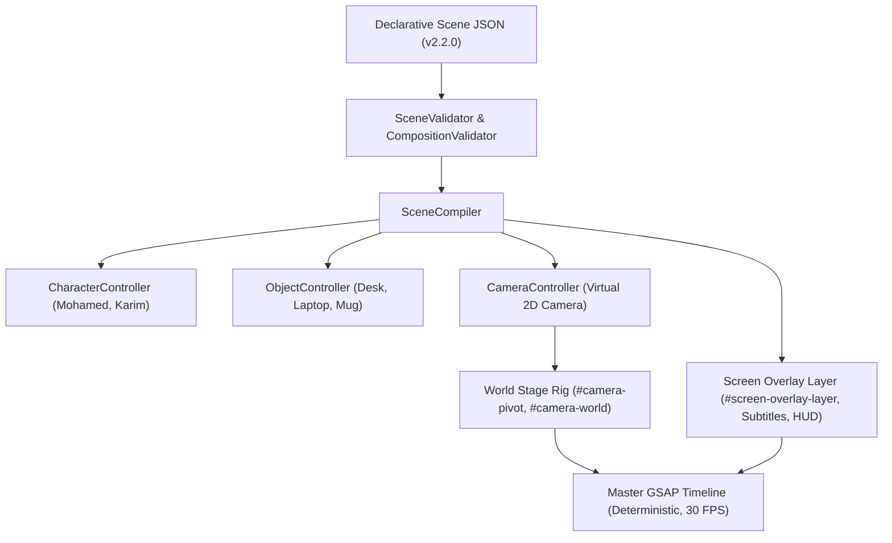
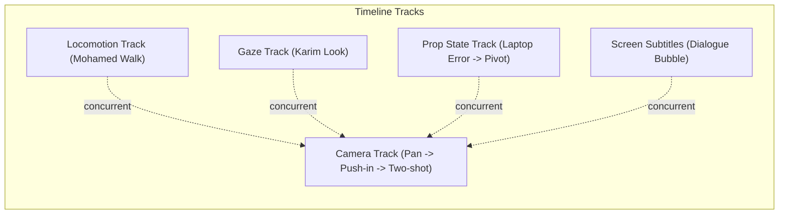
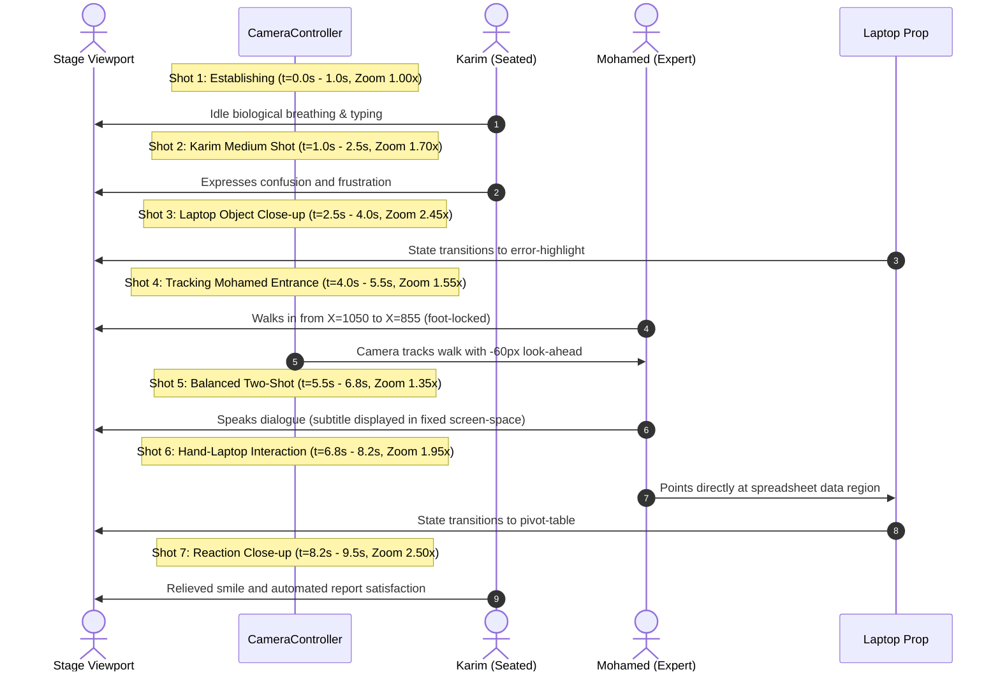

# Mohamed Excel Animation Engine
# Milestone 4: Camera & Cinematic Composition System Architecture

**Document Version:** 1.0.0  
**Engine Release:** SDS v2.2.0  
**Baseline Git Commits:**
- Milestone 1 QA Baseline: `9ba790341ba93a374e16094ea7ea52e3ea1476e4`
- Milestone 2 Scene Direction System (SDS): `c74f6e4a643adca14e38e121544ee03f8f94689b`
- Milestone 3 Object Animation & Interaction System: `ff10e4beffdf26b7bf4477dca68c7792340a3870`
- Milestone 4 Camera & Cinematic Composition System: Current

---

## 1. Executive Summary & Objective

Milestone 4 establishes the **Camera & Cinematic Composition System**, elevating the virtual camera into a **first-class entity** within the Scene Direction System (SDS), alongside characters and interactive objects.

Directors can now specify shot compositions, framing presets, camera movements (pans, zooms, tracking, follow-paths), and cinematic shot transitions (cuts, dissolves) entirely through declarative JSON without manually calculating camera matrices, writing GSAP timelines, or touching JavaScript.



### Key Capabilities Introduced
1. **Strict World-Space vs. Screen-Space Separation:** World entities (actors, furniture, props) move relative to the camera inside `#camera-world`, while UI elements, subtitles, captions, and logos remain fixed in `#screen-overlay-layer`.
2. **Deterministic Camera Transformations:** 2D affine matrix math translating camera center $(C_x, C_y)$, magnification zoom $Z$, and tilt rotation $\theta$ into screen coordinates with $< 0.05\text{px}$ discrepancy against live DOM CTM.
3. **Dynamic Framing Presets & Bounding Box Engine:** Computes optimal framing (`establishing`, `full`, `medium`, `close-up`, `extreme-close-up`, `two-shot`, `object-close-up`, `interaction`) dynamically from live subject bounding boxes, applying padding ratios and vertical/horizontal bias.
4. **Target Tracking & Look-Ahead Kinematics:** Smoothly follows moving characters or props, applying customizable look-ahead offsets to lead the subject's movement direction.
5. **Composition & Visual Safety Validator (`CompositionValidator`):** Verifies subject visibility, detects caption obscuration over character faces or active interaction sockets, and flags excessive camera velocity or abrupt zoom jumps.
6. **Backwards-Compatible JSON Schema v2.2.0:** Extended schema supporting `camera` configuration and camera events without breaking Milestones 1, 2, or 3 specifications.

---

## 2. Spatial Coordinate System & Transformations

### 2.1 Coordinate Conventions
- **Composition Dimensions:** $1080 \times 1920\text{ px}$ (Portrait 9:16 aspect ratio).
- **Viewport Center:** $(540.0, 960.0)\text{ px}$.
- **Stage Origin:** Top-left $(0.0, 0.0)$.
- **Floor Plane Anchor:** $Y = 1386.0\text{ px}$.

### 2.2 Forward Transformation: World Space $\to$ Screen Space
For a camera centered at $(C_x, C_y)$ in world space with magnification zoom $Z$ and tilt angle $\theta$ (in radians):

$$\begin{pmatrix} \Delta x \\ \Delta y \end{pmatrix} = \begin{pmatrix} X_w - C_x \\ Y_w - C_y \end{pmatrix}$$

$$\begin{pmatrix} \Delta x_{\text{rot}} \\ \Delta y_{\text{rot}} \end{pmatrix} = \begin{pmatrix} \cos\theta & -\sin\theta \\ \sin\theta & \cos\theta \end{pmatrix} \begin{pmatrix} \Delta x \\ \Delta y \end{pmatrix}$$

$$\begin{pmatrix} X_s \\ Y_s \end{pmatrix} = \begin{pmatrix} 540 \\ 960 \end{pmatrix} + Z \cdot \begin{pmatrix} \Delta x_{\text{rot}} \\ \Delta y_{\text{rot}} \end{pmatrix}$$

### 2.3 Inverse Transformation: Screen Space $\to$ World Space
Given a point on screen $(X_s, Y_s)$, the inverse transformation evaluates the corresponding world point:

$$\begin{pmatrix} \Delta x_s \\ \Delta y_s \end{pmatrix} = \frac{1}{Z} \begin{pmatrix} X_s - 540 \\ Y_s - 960 \end{pmatrix}$$

$$\begin{pmatrix} X_w \\ Y_w \end{pmatrix} = \begin{pmatrix} C_x \\ C_y \end{pmatrix} + \begin{pmatrix} \cos\theta & \sin\theta \\ -\sin\theta & \cos\theta \end{pmatrix} \begin{pmatrix} \Delta x_s \\ \Delta y_s \end{pmatrix}$$

### 2.4 The Two-Stage DOM Camera Rig
Rather than calculating and modifying hundreds of child SVG elements individually, the `SceneCompiler` encapsulates world space into an optimized two-node camera hierarchy:

```html
<div id="stage-viewport" style="width: 1080px; height: 1920px; overflow: hidden; position: relative;">
  <!-- Camera Stage Rig (World Space) -->
  <div id="camera-stage" style="position: absolute; inset: 0; pointer-events: none;">
    <div id="camera-pivot" style="position: absolute; left: 540px; top: 960px; width: 0; height: 0; transform-origin: 0 0;">
      <div id="camera-world" style="position: absolute; left: -540px; top: -960px; width: 1080px; height: 1920px; pointer-events: auto;">
        <!-- Environmental Layers, Actors, Props -->
        <div id="env-layer">...</div>
        <div id="actor-container-karim">...</div>
        <div id="desk-layer">...</div>
        <div id="actor-container-mohamed">...</div>
      </div>
    </div>
  </div>

  <!-- Screen Overlay Layer (Screen Space) -->
  <div id="screen-overlay-layer" style="position: absolute; inset: 0; pointer-events: none; z-index: 100;">
    <div id="captions-container">...</div>
    <div id="safe-area-overlay">...</div>
  </div>
</div>
```

**Mechanical Properties:**
1. `#camera-pivot` is positioned at the screen viewport center $(540, 960)$ with `transform-origin: 0 0`. It handles **magnification zoom** (`scale: Z`) and **camera tilt** (`rotation: theta`).
2. `#camera-world` has a default offset of $(-540, -960)$. Translating it by `x: -(Cx - 540), y: -(Cy - 960)` places world point $(C_x, C_y)$ directly under the pivot.
3. Overlays inside `#screen-overlay-layer` are outside `#camera-stage` and maintain strict screen positioning (zero drift during zoom or pan).

---

## 3. The CameraController API

The `CameraController` class (`lib/sds/camera-controller.js`) controls virtual camera framing, motion, and timeline compilation.

### 3.1 Framing Presets

| Preset | Target Scale | Default Zoom Range | Vertical Bias | Purpose |
| :--- | :---: | :---: | :---: | :--- |
| `establishing` | $1.00$ | $1.00\times$ | $0.00$ | Wide view establishing the environment. |
| `full` | $0.72$ | $1.10\times - 1.60\times$ | $+0.05$ | Full character view including feet and headroom. |
| `medium` | $0.55$ | $1.50\times - 2.20\times$ | $-0.15$ | Waist-up framing emphasizing posture and gestures. |
| `close-up` | $0.35$ | $2.20\times - 3.20\times$ | $-0.22$ | Tight framing on head and facial expressions. |
| `extreme-close-up` | $0.18$ | $3.20\times - 5.00\times$ | $-0.25$ | Intense focus on eyes, mouth, or prop micro-details. |
| `two-shot` | $0.75$ | $1.10\times - 1.80\times$ | $-0.05$ | Balanced composition framing two characters together. |
| `over-the-shoulder` | $0.50$ | $1.60\times - 2.40\times$ | $-0.10$ | Framed from behind foreground character towards focal target. |
| `object-close-up` | $0.45$ | $1.80\times - 3.50\times$ | $0.00$ | High-legibility framing for laptop screen, document, mug. |
| `interaction` | $0.55$ | $1.50\times - 2.50\times$ | $0.00$ | Frames active contact zone between hand and prop. |

### 3.2 Core Methods & Signatures

| Method | Parameters | Description |
| :--- | :--- | :--- |
| `worldToScreen(pt, state)` | `(worldPoint, [customState])` | Converts world coordinates $(X_w, Y_w)$ to screen coordinates $(X_s, Y_s)$. |
| `screenToWorld(pt, state)` | `(screenPoint, [customState])` | Inverse conversion from screen $(X_s, Y_s)$ to world $(X_w, Y_w)$. |
| `calculateFraming(target, preset)` | `(target, [framingPreset], [controllers], [objects])` | Evaluates subject bounding boxes and returns optimal `{ x, y, zoom }`. |
| `cutTo(params)` | `{ target, framing, x, y, zoom, atTime, tl }` | Instant camera cut (duration 0). |
| `moveTo(params)` | `{ target, framing, x, y, zoom, duration, ease, atTime, tl }` | Smooth camera interpolation between framings or coordinates. |
| `focusOn(params)` | `{ target, framing, duration, ease, atTime, tl }` | Automatically resolves target bounds and frames subject. |
| `follow(params)` | `{ target, framing, toX, lookAhead, duration, ease, atTime, tl }` | Tracks moving character/prop with customizable lead offset. |
| `reset(params)` | `{ duration, ease, atTime, tl }` | Restores camera to default establishing shot $(540, 960, 1.0\times)$. |

---

## 4. Action Registry & Subsystem Integration

Milestone 4 introduces the `SUBSYSTEMS.CAMERA` lock (`camera`), preventing conflicting simultaneous camera instructions while enabling seamless concurrency with character and prop subsystems.



### Declarative Actions in Action Registry:
1. `cameraSet`: Instant configuration without tweening.
2. `cameraMoveTo`: Interpolated movement to coordinate or target framing.
3. `cameraPanTo`: Dedicated horizontal or vertical camera pan.
4. `cameraZoomTo`: Magnification push-in or pull-out around focal point.
5. `cameraReset`: Return to stage center wide view.
6. `cameraFocus`: Subject framing shortcut.
7. `cameraFollow`: Entity tracking with lead look-ahead.
8. `frameCharacter`, `frameObject`, `frameGroup`, `frameInteraction`: High-level framing presets.
9. `cutTo`, `dissolveTo`, `zoomTransition`, `panTransition`: Seekable shot transitions.

---

## 5. Composition & Cinematic Safety Validator

The `CompositionValidator` (`lib/sds/composition-validator.js`) statically validates scene choreography:

1. **Title-Safe & Action-Safe Areas:** Enforces mobile safe margins ($140\text{px}$ top, $180\text{px}$ bottom, $80\text{px}$ sides) ensuring captions and primary character features remain clear of platform UI overlays.
2. **Subject Visibility Analysis:** Ensures framed targets fall within the screen viewport boundaries throughout the shot.
3. **Caption Occlusion Prevention:** Flags dialogue subtitles positioned too close to active interaction targets or character faces.
4. **Framing Stability:** Monitors velocity ($\le 2800\text{ px/s}$) and zoom acceleration ($\le 4.0\times\text{/s}$) to guarantee viewer comfort and avoid jarring camera jumps.

---

## 6. Benchmark 5: Cinematic Office Sequence

The benchmark specification (`benchmarks/benchmark-cinematic-camera.json`) verifies all 7 cinematic shot types over a $9.5\text{-second}$ narrative arc:



---

## 7. Verification Summary & QA Results

| Test Category | Requirement | Measured Result | Verdict |
| :--- | :--- | :--- | :---: |
| **Test A: Coordinate Transforms** | Analytical vs DOM CTM ($< 0.05\text{ px}$) | **$0.0000\text{ px}$ discrepancy** across 5 test cases | **PASS** |
| **Test A: Inverse Transform** | Screen-to-world round-trip ($< 0.001\text{ px}$) | **$0.000000\text{ px}$ error** | **PASS** |
| **Test B: Framing Presets** | 7 presets within target zoom & viewport | **$100\%$ valid bounds & margin fit** | **PASS** |
| **Test C & D: Tracking & Follow** | Mohamed entry with look-ahead | **Smooth tracking ($X=1050 \to 855$), zero jitter** | **PASS** |
| **Test E: Concurrency** | Locomotion + prop + camera + subtitles | **Independent parallel execution, 0 collisions** | **PASS** |
| **Test F: Shot Transitions** | Frame continuity across cut/pan/zoom | **Continuous monotonic interpolation** | **PASS** |
| **Test G: Screen Overlay Stability** | Subtitle screen position during pan/zoom | **$0.0000\text{ px}$ screen drift** ($t=0.0 \to 9.5\text{s}$) | **PASS** |
| **Test H: Deterministic Seek** | Random seek order vs forward seek | **$100\%$ identical DOM matrices** | **PASS** |
| **Regression: Benchmark 1** | Milestone 2 interaction benchmark | **Valid (0 errors)** | **PASS** |
| **Regression: Benchmark 2** | Milestone 2 coffee talk benchmark | **Valid (0 errors)** | **PASS** |
| **Regression: Benchmark 3** | Milestone 3 cup pick-up benchmark | **Valid (0 errors)** | **PASS** |
| **Regression: Benchmark 4** | Milestone 3 object motion benchmark | **Valid (0 errors)** | **PASS** |
| **Video Export: Benchmark 5** | 9.5s @ 30 FPS MP4 review proxy | **285 frames, H.264, 540×960, 9.50s** | **PASS** |
