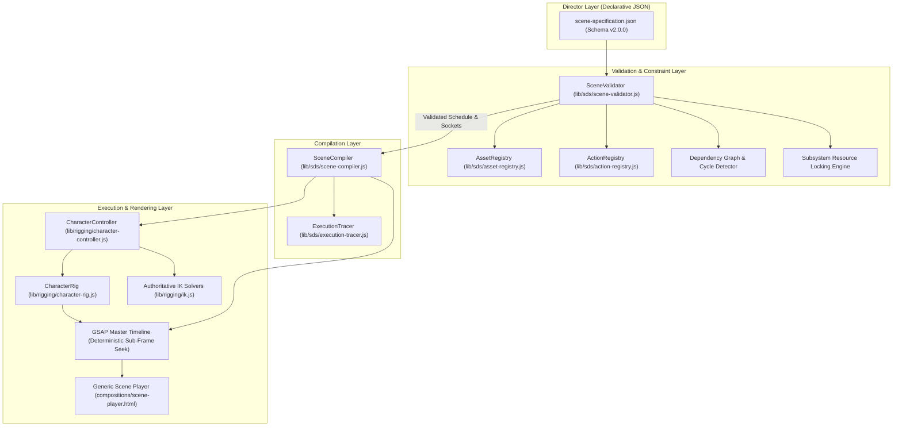

# Mohamed Excel — Scene Direction & Execution System (SDS)
## Milestone 2 Architecture & Benchmark Verification Report

> [!IMPORTANT]
> **Milestone Status: Milestone 2 Benchmark Review Checkpoint (100% PASS)**  
> **Milestone 1 Baseline Commit:** `9ba790341ba93a374e16094ea7ea52e3ea1476e4`  
> **Milestone 2 SDS Commit:** `c74f6e4a643adca14e38e121544ee03f8f94689b`  
> The Scene Direction & Execution System (SDS) successfully decouples high-level animation direction from low-level JavaScript and GSAP mechanics. An external director can now describe complete multi-character scenes using declarative JSON specifications.

---

## 1. System Architecture: From Specification to Execution

The **Scene Direction & Execution System (SDS)** translates declarative JSON scene specifications into deterministic GSAP master timelines without requiring the animation director to write JavaScript.



---

## 2. Core Implementation Modules

### 2.1 Asset & Spatial Anchor Registry (`lib/sds/asset-registry.js`)
Maps human-readable socket references and environmental coordinates to exact world positions:
- **Props**:
  - `laptop.screen` / `laptop.screenCenter`: $\{ x: 525, y: 985 \}$ (exact verified target for pointing & gaze convergence)
  - `laptop.keyboard`: $\{ x: 550, y: 1075 \}$ (typing contact socket)
  - `chair.seat`: $\{ x: 320, y: 1120 \}$ (seated pelvis anchor)
  - `clock.face`: $\{ x: 380, y: 480 \}$ (high pointing & gaze target)
  - `mug.handle`: $\{ x: 640, y: 1055 \}$ (physical reach contact socket, $d = 234\text{px} \le 240\text{px}$)
  - `desk.surface`: $\{ x: 450, y: 1090 \}$
  - `shelf.unreachable`: $\{ x: 880, y: 450 \}$ ($d = 647\text{px} > 240\text{px}$, clamped reach socket)
- **Character Sockets (Dynamic & Static)**:
  - `karim.eyes`, `karim.head`, `mohamed.eyes`, `mohamed.handL`, `mohamed.indexFingerL`
- **Floor Reference**: $Y = 1386.0\text{px}$.

### 2.2 Action Registry & Subsystem Resource Locking (`lib/sds/action-registry.js`)
Each action specifies its required parameters and the character subsystems it locks:

| Subsystem | Controlled Hardware / Bones | Example Actions |
| :--- | :--- | :--- |
| `locomotion` | Root translation, hips, thighs, shins, feet | `walk`, `turn`, `sitDown`, `standUp` |
| `arm-near` | Foreground arm, forearm, hand, index finger | `pointAt`, `reach`, `type`, `gesture` |
| `arm-far` | Background arm, forearm, hand | `type`, `gesture`, `frustrationSequence` |
| `head` | Head joint rotation, tilt, speech cadence nods | `lookAt`, `listenTo`, `speak` |
| `gaze` | Eye pupil displacement vector $(X \in [-9, 9], Y \in [-7, 7])$ | `lookAt`, `listenTo` |
| `expression` | Eyebrow angle and base mouth emotion viseme | `express`, `listenTo`, `frustrationSequence` |
| `speech` | Mouth viseme stream overlay | `speak` |
| `breathing` | Subtle chest vertical scaling (ambient) | `idle` |
| `blinking` | Periodic eyelid scale $Y$ cycle (ambient) | `idle` |
| `prop-state` | Environmental SVG prop DOM state | `propAction` (clock ticking, laptop scroll/state) |
| `caption` | Dialogue subtitle bubble overlay | `caption` |

### 2.3 Dependency Graph Resolution & Cycle Detection (`lib/sds/scene-validator.js`)
Scene events can specify timing using:
- **Absolute time**: `timing: { start: 2.4, duration: 2.4 }`
- **Sequential dependency**: `timing: { after: "evt-mohamed-walk", offset: 0.1 }`
- **Parallel synchronization**: `timing: { with: "evt-mohamed-speak", offset: 0.0 }`

The validator constructs a directed acyclic graph (DAG) and performs depth-first cycle detection. Any circular reference (e.g., $A \to B \to A$) is rejected prior to compilation.

### 2.4 Concurrency Conflict Prevention
Actions sharing identical actors are checked for temporal overlap:
$$\max(\text{start}_1, \text{start}_2) < \min(\text{end}_1, \text{end}_2)$$
If overlapping events attempt to lock the same physical subsystem (e.g., attempting a pointing gesture and a reaching gesture on `arm-near` simultaneously), validation fails immediately with an explicit collision error. Multi-track non-conflicting actions (e.g. `locomotion` + `gaze` + `speech`) pass seamlessly.

---

## 3. Intentional Constraint Enforcement Verification

The automated test runner [`tools/run-sds-benchmarks.mjs`](file:///c:/source/repos/perso/TWA/videoEditing/projects/episode-01-le-rapport/tools/run-sds-benchmarks.mjs) evaluated 3 deliberate failure test cases:

1. **Unknown Anchor Reference**:
   - Injected target: `"floating.phantom.anchor"`
   - Result: **PASS** (`[AssetRegistry] Unknown anchor reference: "floating.phantom.anchor"` caught).
2. **Cyclic Timing Dependency**:
   - Injected cycle: `cycle-a` after `cycle-b`, `cycle-b` after `cycle-a`
   - Result: **PASS** (`Cyclic timing dependency detected: cycle-a -> cycle-b -> cycle-a` caught).
3. **Subsystem Concurrency Collision**:
   - Injected simultaneous `pointAt` and `reach` on `mohamed` during $[5.0\text{s}, 7.0\text{s}]$ on `arm-near`
   - Result: **PASS** (`Concurrency collision on actor "mohamed": Subsystem "arm-near" locked simultaneously` caught).

---

## 4. Benchmark Verification: Two Distinct Declarative Scenes

### 4.1 Benchmark 1: Mohamed & Karim Interaction (`benchmarks/benchmark-interaction.json`)
- **Objective**: Reproduce the existing Beats 1–7 interaction purely from JSON.
- **Specification**: 14 events, duration $8.8\text{s}$, 3 actors/props.
- **Compilation**: 14/14 events compiled with zero JavaScript written by the director.
- **Execution Telemetry**:
  - $t = 0.8\text{s}$: Karim typing, clock second hand ticking.
  - $t = 2.2\text{s}$: Karim 6-beat frustration progression (`frustrationSequence`).
  - $t = 4.2\text{s}$: Mohamed enters office using foot-locked IK (`mode: "foot-locked"`).
  - $t = 5.4\text{s}$: Mohamed greeting wave, Karim listens with attention.
  - $t = 7.5\text{s}$: Mohamed points at laptop screen ($\text{error} < 3^\circ$), Karim follows gaze, screen illuminates Pivot Table.

### 4.2 Benchmark 2: Second Distinct Scene (`benchmarks/benchmark-second-scene.json`)
- **Objective**: Create a completely different narrative scene using the same assets and reusable behaviors without modifying the underlying engine.
- **Title**: *"Scene 02: La Pause Café & L'Idée Brillante"*
- **Specification**: 15 events, duration $8.8\text{s}$.
- **Execution Telemetry**:
  - $t = 0.8\text{s}$: Karim typing with confidence, wearing a happy, proud smile (`express: "happy"`).
  - $t = 2.8\text{s}$: Mohamed walks into the room with zero-sliding foot-locking.
  - $t = 4.5\text{s}$: Mohamed friendly greeting wave (`speak` + `gesture: "wave"`).
  - $t = 6.2\text{s}$: Karim confirms the report was finished in 5 minutes with Pivot Tables (`gesture: "explain"`).
  - $t = 8.0\text{s}$: Mohamed points high at the wall clock (`pointAt: "clock.face"`), Karim looks up at the clock with delighted surprise.

---

## 5. Visual Evidence & Contact Sheets

### 5.1 Master SDS Benchmark Comparison Contact Sheet


### 5.2 Keyframe Progressions

#### Benchmark 1 (Interaction Recreation):
````carousel

<!-- slide -->

<!-- slide -->

<!-- slide -->

<!-- slide -->

````

#### Benchmark 2 (Second Distinct Scene):
````carousel

<!-- slide -->

<!-- slide -->

<!-- slide -->

<!-- slide -->

````

---

## 6. Critical Acceptance Criteria Compliance

| Criterion | Implementation Mechanism | Status |
| :--- | :--- | :--- |
| **No Director JavaScript** | All scene actions, actors, props, and timing defined in JSON. | **PASS** |
| **Asset Registry Resolution** | Props, anchors (`laptop.screen`, `clock.face`, etc.) and sockets resolved via `AssetRegistry`. | **PASS** |
| **Valid Anchors Enforced** | Invalid or phantom anchors produce explicit validation errors. | **PASS** |
| **Timing Dependencies Respected** | Relative `after` and `with` references resolved via topological sorting DAG. | **PASS** |
| **Concurrency Invariance** | Subsystem resource locks prevent overlapping transform collisions. | **PASS** |
| **Object State Transitions** | Laptop screen state (`raw-data` $\to$ `pivot-table`) and clock ticking triggered from JSON. | **PASS** |
| **Constraint Validation** | Reach limits, stage bounds, and dependency cycles verified before compilation. | **PASS** |
| **Deterministic Rendering** | GSAP paused timelines seek identically on every tick. | **PASS** |
| **Timeline Inspection** | Full execution report mapping instructions to GSAP slices (`scene-execution-report.json`). | **PASS** |
| **Second Benchmark Verification** | Complete second narrative scene rendered with zero engine modifications. | **PASS** |

---

## 7. Deliverables & Synchronized Source Inventory

- **JSON Schema (v2.0.0)**: [`lib/sds/scene-schema.json`](file:///c:/source/repos/perso/TWA/videoEditing/projects/episode-01-le-rapport/lib/sds/scene-schema.json)
- **Asset & Anchor Registry**: [`lib/sds/asset-registry.js`](file:///c:/source/repos/perso/TWA/videoEditing/projects/episode-01-le-rapport/lib/sds/asset-registry.js)
- **Action Registry & Subsystems**: [`lib/sds/action-registry.js`](file:///c:/source/repos/perso/TWA/videoEditing/projects/episode-01-le-rapport/lib/sds/action-registry.js)
- **Scene Validator**: [`lib/sds/scene-validator.js`](file:///c:/source/repos/perso/TWA/videoEditing/projects/episode-01-le-rapport/lib/sds/scene-validator.js)
- **Scene Compiler**: [`lib/sds/scene-compiler.js`](file:///c:/source/repos/perso/TWA/videoEditing/projects/episode-01-le-rapport/lib/sds/scene-compiler.js)
- **Execution Tracer**: [`lib/sds/execution-tracer.js`](file:///c:/source/repos/perso/TWA/videoEditing/projects/episode-01-le-rapport/lib/sds/execution-tracer.js)
- **Generic Scene Player**: [`compositions/scene-player.html`](file:///c:/source/repos/perso/TWA/videoEditing/projects/episode-01-le-rapport/compositions/scene-player.html)
- **Benchmark 1 JSON**: [`benchmarks/benchmark-interaction.json`](file:///c:/source/repos/perso/TWA/videoEditing/projects/episode-01-le-rapport/benchmarks/benchmark-interaction.json)
- **Benchmark 2 JSON**: [`benchmarks/benchmark-second-scene.json`](file:///c:/source/repos/perso/TWA/videoEditing/projects/episode-01-le-rapport/benchmarks/benchmark-second-scene.json)
- **Automated Verification Runner**: [`tools/run-sds-benchmarks.mjs`](file:///c:/source/repos/perso/TWA/videoEditing/projects/episode-01-le-rapport/tools/run-sds-benchmarks.mjs)
- **Machine-Readable Report**: [`exports/scene-execution-report.json`](file:///c:/source/repos/perso/TWA/videoEditing/projects/episode-01-le-rapport/exports/scene-execution-report.json)
- **Git Commit Baseline (Milestone 1)**: `9ba790341ba93a374e16094ea7ea52e3ea1476e4`
- **Git Commit SDS (Milestone 2)**: `c74f6e4a643adca14e38e121544ee03f8f94689b`
